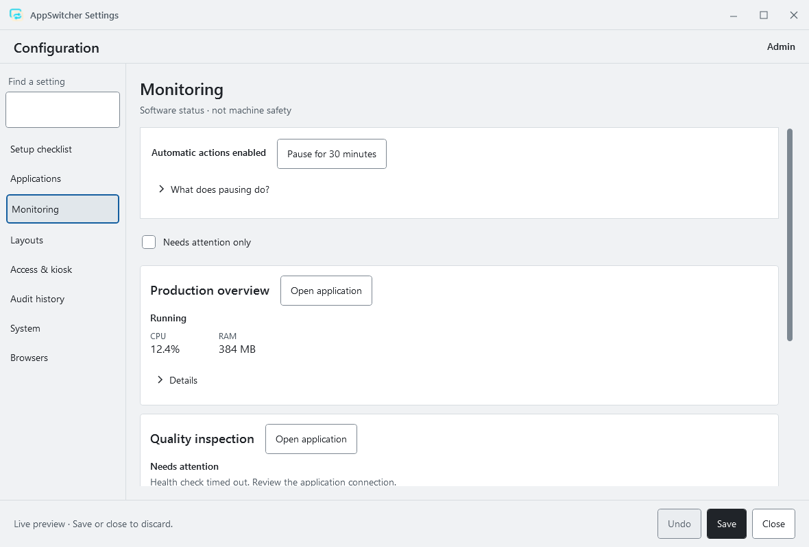

# AppSwitcher

[](https://github.com/Sparkz400/AppSwitcher/actions/workflows/verify.yml)
[](https://github.com/Sparkz400/AppSwitcher/actions/workflows/codeql.yml)
[](https://github.com/Sparkz400/AppSwitcher/releases/latest)

A native Windows launcher for operator and maintenance workstations. Keep assigned applications within reach, return to the same browser tab, inspect software health and restore window layouts from one compact interface.

[Download the latest release](https://github.com/Sparkz400/AppSwitcher/releases/latest) · [Installation and rollback](docs/INSTALLATION.md) · [Examples](examples/README.md) · [Get help](SUPPORT.md) · [Roadmap](ROADMAP.md) · [Contribute](CONTRIBUTING.md)

[View the candidate UI](docs/images/maintenance-light.png) · [Demo walkthrough](docs/DEMO.md) · [Keyboard reference](docs/KEYBOARD.md) · [Troubleshooting](docs/TROUBLESHOOTING.md)



## What it does

- A touch-friendly launcher with favourites, groups and operator-specific application access.
- A maintenance workspace for applications, monitoring, layouts, access/kiosk settings and audit history.
- Paired Chrome, Edge and Firefox tabs: restore/activate the same managed tab, report uncertain identity, and leave unrelated tabs alone.
- Optional application supervision, watchdog recovery, schedules, startup/stop hooks and window placement.
- A first-run checklist, live needs-attention filter, backup/import previews and authenticated recovery of damaged configuration.
- Stable Windows display identities, English/German, light/dark themes, Windows high contrast and keyboard-accessible controls.

Version **1.2.0** uses unsigned Windows distribution. Its [publication decision and verification limits](docs/RELEASE_ACCEPTANCE_1.2.0.md) record the completed software checks and deferred deployment checks. AppSwitcher is not a machine safety controller. PIN access protects application controls and does not replace Windows account security. Site-specific kiosk, power-loss, touch and display behavior needs [workstation acceptance](docs/WORKSTATION_ACCEPTANCE.md).

## Start in a few minutes

1. Download the `win-x64-…-setup.exe` or complete portable ZIP and its adjacent checksum from [Releases](https://github.com/Sparkz400/AppSwitcher/releases). Windows packages are unsigned, including stable releases; follow the [download verification instructions](docs/INSTALLATION.md).
2. Install as the intended Windows user, or extract the complete ZIP and open `app\AppSwitcher.exe`. The .NET runtime is included; no SDK or internet connection is needed on the target PC for installation.
3. Choose an administrator PIN and follow **Settings → Setup checklist**. Add an application, use **Add from an open window**, or import a [safe starter example](examples/README.md).
4. For websites, follow [browser setup](docs/BROWSER_INTEGRATION.md) and select the connected profile. The offline package includes unpacked Chrome/Edge extensions and the Mozilla-signed Firefox 1.1.0 extension. Browser session restoration must also be enabled in the chosen profile.

The installer does not launch applications, enable kiosk or install browser extensions automatically. Once you start AppSwitcher, your saved automatic-launch/kiosk settings apply. Back up existing configuration before an update; keep the previous release for rollback.

## Requirements and support

The release target is Windows 11 x64. The installer also permits compatible Windows 10 build 19041+, but an installable OS/browser is not necessarily vendor-supported or site-qualified. See the exact compatibility and support boundaries in [Maintenance](MAINTENANCE.md). Browsers are installed separately. Online websites still need their usual network access.

This is a community project with no guaranteed support response time. See [Support](SUPPORT.md) for questions, reproducible bug reports and feature requests. Report vulnerabilities through the [private security route](SECURITY.md).

## Build and verify

On Windows, install PowerShell 7, Node.js 24 and the .NET SDK pinned in `global.json`:

```powershell
./scripts/verify.ps1
./scripts/build-release.ps1
```

Verification runs locked-dependency builds, .NET and browser-extension tests, native UI checks and isolated process/recovery scenarios. The release builder produces a self-contained ZIP, unsigned per-user installer, store-submission bundle, file manifest, checksums and SPDX dependency inventory. Beta.3 and later include [verifiable build and release records](docs/VERIFY_DOWNLOADS.md). It checks the installer through fresh install, blocked in-use updates, upgrade, rollback and uninstall. Build-time downloads require internet access.

The native checks open synthetic windows and preserve the real saved configuration. They do not establish real-machine qualification. See [Contributing](CONTRIBUTING.md) for focused tests, longer runs and browser checks, and [delivery evidence](docs/DELIVERY_CHECKLIST.md) for the recorded scope and remaining acceptance work.

## Guides

| Task | Guide |
| --- | --- |
| Install, update, roll back or uninstall | [Installation](docs/INSTALLATION.md) |
| Pair and recover browser profiles/tabs | [Browser integration](docs/BROWSER_INTEGRATION.md) |
| Configure operation, access, watchdog and diagnostics | [Operations](docs/OPERATIONS.md) |
| Start from a safe configuration | [Examples](examples/README.md) |
| Qualify a deployment | [Workstation acceptance](docs/WORKSTATION_ACCEPTANCE.md) |
| Review software checks and their limits | [Validation record](docs/VALIDATION.md) |
| Prepare a later store submission | [Store materials](docs/store/README.md) |
| Understand releases and support | [Changelog](CHANGELOG.md), [Maintenance](MAINTENANCE.md) |

## License and provenance

AppSwitcher is licensed under [MIT](LICENSE). Runtime dependencies retain their [third-party licenses and notices](THIRD_PARTY_NOTICES.md). Screenshots use synthetic demonstration data. The public repository starts from a reviewed clean source snapshot; prior development history was excluded to avoid publishing historical local configuration. See [publication review](docs/PUBLICATION_REVIEW.md).
