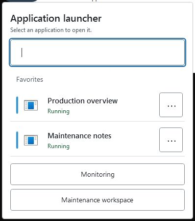
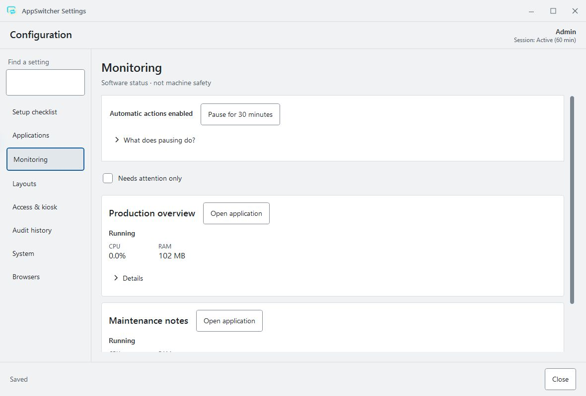

# A short AppSwitcher walkthrough

[Play the 27-second demo](images/quick-tour.gif). The README keeps a static image so the animation starts only when you open it. Reload the GIF to replay it.

The recording uses the real Windows interface with two synthetic sample applications. It leads with everyday launching and switching, then opens maintenance:

1. Open the launcher and choose **Production overview**.
2. See the sample application's window. AppSwitcher reports it as running.
3. Filter for **Maintenance**, then press **Enter** to launch the matching notes app.
4. Both applications now show **Running**. Search for **Production** and press **Enter** to return to its existing window.
5. Open **Maintenance workspace**. Use **Ctrl+F** and search for **monitor**.
6. Press **Enter** to reach the first matching setting, **Window placement**.
7. Open **Monitoring** to inspect the two sample applications' software status.

## Capture notes

Captured on Windows from the 1.2.0-beta.3 working tree, in English/light mode. The existing isolated UI-check host provides a separate configuration, grants its test session maintenance access and exposes its launcher in the taskbar for capture-tool discovery. The shipped application does not gain that test command. The two sample windows are inert test applications; no customer process, browser profile or production configuration is used.

The GIF is an edited sequence of real window captures with explanatory captions, not a continuous timing or performance measurement. Small windows are enlarged for legibility. The switch-back retained the original sample window, and the visible walkthrough checked launcher search/Enter, the enabled global shortcut, settings Ctrl+F/Enter/Escape and forward/reverse Tab navigation. See the [keyboard reference](KEYBOARD.md).

This demonstrates the interface, not machine safety, browser-store distribution, full screen-reader accessibility or representative workstation acceptance. Those remain tracked in the [roadmap](../ROADMAP.md).
