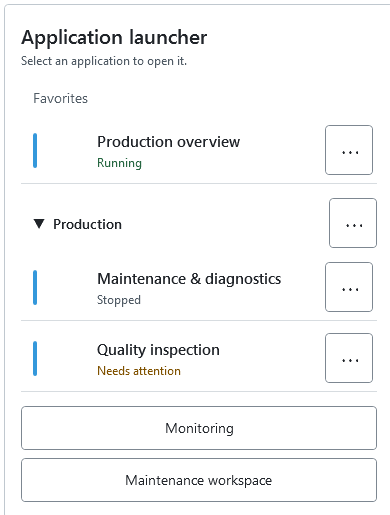
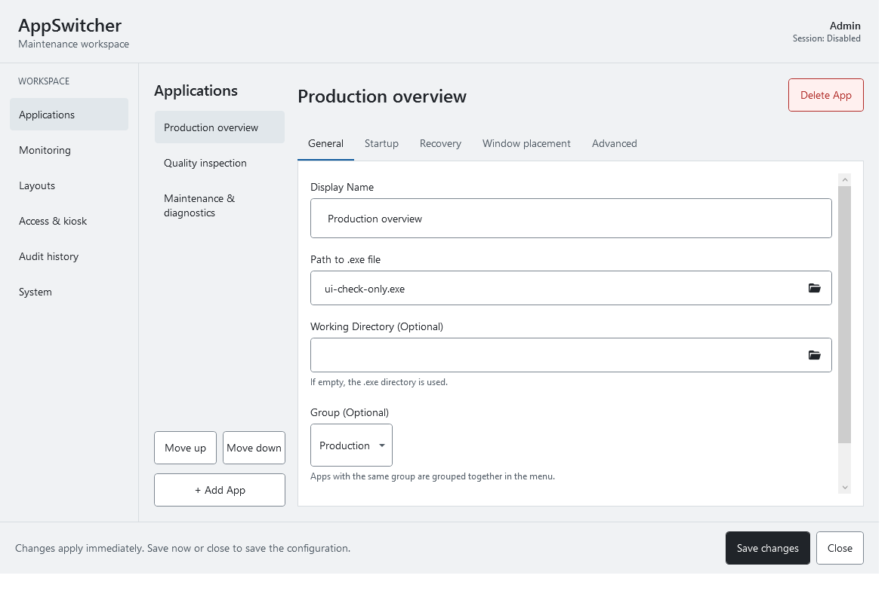
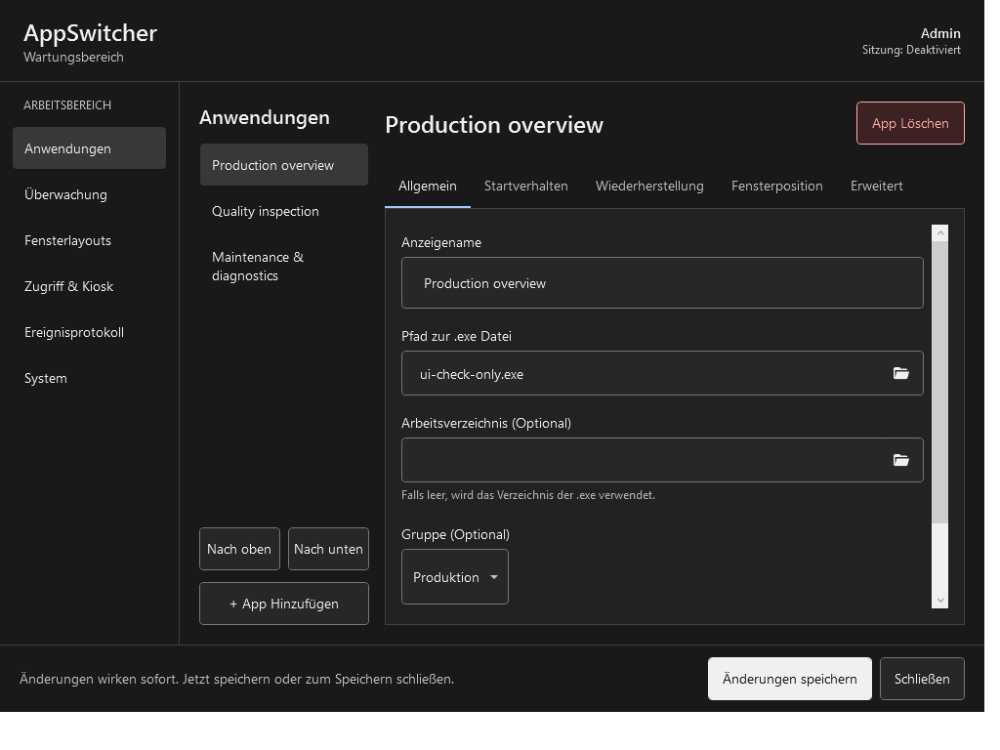
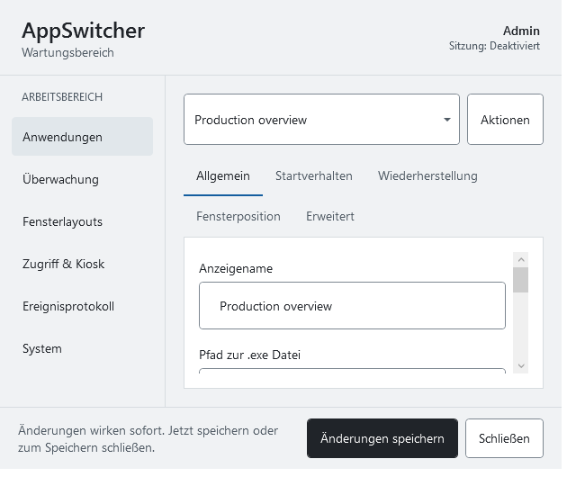

# Precision Console delivery

## Delivered interface

- A labelled, position-lockable operator launcher with stable favourites and groups, written application states, large direct actions and a visible secondary-action menu. The launcher remains topmost and preserves its configured shape, icon, opacity and position behaviour.
- A resizable maintenance workspace with Applications, Monitoring, Layouts, Access & kiosk, Audit history and System sections. Below 1000 logical pixels, the application list becomes a selector with an Actions menu. Tab order remains stable when headers wrap.
- Application editors organised into General, Startup, Recovery, Window placement and Advanced. Every previously exposed application and global settings binding remains represented.
- Shared control styles, neutral light/graphite palettes, visible keyboard focus, accessible names, 44-pixel minimum button and checkbox targets, readable status copy and restrained colour accents.
- A shared monitoring view for the workspace and standalone window. Software health is explicitly distinguished from machine safety.
- PIN entry supports the on-screen keypad and keyboard digits/backspace, retains the 4–8 digit limits and masks entered digits. Dialog content scrolls on shorter screens.
- Explicit save feedback. Invalid input blocks saving and normal editor closure; persistence failures keep edits available. Session expiry still closes privileged windows and pending confirmations.
- Review before configuration import, application removal, watchdog acknowledgement, group start/stop, layout restore/removal and backup restore/deletion. Group stop uses one confirmation listing affected applications. Existing per-application termination confirmation preferences remain effective; new applications default to requiring confirmation.
- Consistent notifications with a dismiss button, longer reading time and pause while hovered or focused. Empty application, monitoring, audit, layout and backup views explain what comes next.

## Compatibility

The configuration schema remains version 9. Existing user configuration is not rewritten by installation or the UI checks. Application lifecycle, scheduling, hooks, dependencies, watchdog, kiosk, audit and access services are reused.

The bundled first-run configuration now uses a neutral rounded-square launcher, a wider menu and a locked position. Existing configuration values remain intact. Application colours identify rows with a narrow accent; primary text uses the shared palette for contrast. The stored `IconOnly` mode is presented as “Icon focused (with label)” so application identity and state remain visible. Text-only and combined presentations remain available.

## Verification

Windows/.NET 10 Release build completed with zero warnings and errors. All **103 automated tests** passed with no skips. The native UI runner completed **1145 assertions**, including:

- All editor tabs and workspace sections across English/light at 1180×800, German/dark at 1024×768, German/light at the 640×560 minimum and English/dark at 900×700.
- Horizontal control bounds, button/checkbox target sizes and shared text/control-border contrast pairs.
- Native WPF resource loading with no binding warnings or errors.
- Launcher UI Automation invocation, Escape from inside its popup, secondary menus and complete launcher placement at a monitor edge.
- Application colour selection without changing launcher colour; keyboard focus traversal; masked and bounded keyboard PIN input.
- Invalid number entry, disabled saving, prevention of closure, correction and cancellation of application removal.
- Operator read-only fields and hidden administrator navigation; empty views; a 150% raster capture of the narrow operator layout.
- Simulated session-expiry callback closes editors even with invalid input and prevents an outstanding recovery confirmation from executing.
- SHA-256 comparison confirms that the user's persisted configuration is unchanged by the native checks.

The test fixture uses synthetic applications, an in-memory configuration save implementation, a memory watchdog store, a no-op application lifecycle and fake kiosk/window-policy platforms. Captures show the actual WPF controls, not browser approximations.

Local receipts are retained under `artifacts/test-results/verified`, `artifacts/ui-checks` and `artifacts/publish`. The UI check command above regenerates its captures. No repository CI workflow was present; these are local Windows results.

## Qualification still required

Physical touch accuracy, gloves, customer workflows, actual process integration, real kiosk enforcement, Narrator reading order, Windows high-contrast mode and mixed-DPI multi-monitor movement need testing on the intended deployment. The scaled capture is a rendering check, not a physical display qualification. The redesign does not certify machine safety.

## Native captures

